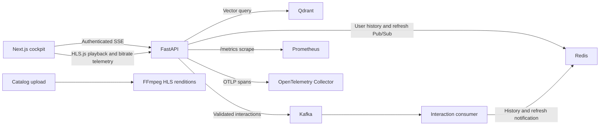

# Explainable Streaming Recommendations: Production Cockpit and Performance Evaluation

**Technical report · 12 October 2026**  
**Evaluation profile:** deterministic synthetic sessions, 10,000 sessions, seed 17, cutoff 10

## Abstract

This report describes a production-oriented streaming recommendation cockpit built around a Next.js 14 App Router frontend and a FastAPI service. The web cockpit combines adaptive HLS playback, player telemetry, vector-match explanations, and a server-sent recommendation feed. The service uses vector retrieval, contextual ranking, Redis interaction profiles, and Kafka interaction delivery. Prometheus metrics and OpenTelemetry spans expose service behavior across retrieval, ranking, transcoding, and event processing.

A deterministic synthetic ranking exercise provides reproducible metric calculation and a smoke baseline. On 10,000 generated sessions, the seeded reference run produced MRR@10 **0.7991**, NDCG@10 **0.5263**, and Precision@10 **0.1435**. These values describe the synthetic ranking generator, not production user outcomes or an offline evaluation of a trained model.

## System design

The primary interface is the Next.js 14 App Router application. Tailwind CSS supplies utility styling and the UI uses small Shadcn-style Button and Card primitives. HLS.js attaches to the native video element, reads master-playlist levels, allows manual rendition selection, and reports playback position, buffer depth, active height, and bitrate. Rendition choices are 4K, 1080p, and 720p when source-compatible renditions are present; ingestion also creates a 360p fallback.

The browser opens `GET /api/v1/recommendations/stream` with an authenticated fetch stream. The API subscribes to a user-scoped Redis Pub/Sub refresh channel before sending an initial recommendation. The Kafka interaction consumer appends accepted interactions to Redis history and publishes an invalidation event. The API recomputes and sends the updated explainable recommendation. Upload status continues to use the existing status resource; live recommendation updates use SSE.



The Compose stack exposes the primary web app on host ports 3000 and 3001, the API on 8000, Prometheus on 9090, and Qdrant on 6333. Streamlit is available only through the `legacy` Compose profile and has an entry point at `/legacy`.

### Framework security boundary

The requested Next.js 14 line is end of life. The project pins 14.2.35, but the current full npm audit still reports a critical advisory for Next.js 14. Next.js is a build-only dependency: the runtime image contains Nginx and static export files, not `next start` or the image optimizer; `npm audit --omit=dev` reports no production dependency advisories. This reduces runtime exposure for this deployment, but does not patch the build toolchain. A supported Next.js release line is required to clear the full audit.

## Instrumentation

The API exposes `/metrics` for Prometheus. Metrics include candidate retrieval and contextual ranking latency histograms, active bitrate by rendition, Redis user-profile hit/miss counts, and observed Kafka consumer lag. A profile hit means Redis returned at least one history entry; a miss means the history was empty. The profile hit ratio can be derived from these counters as `hit / (hit + miss)`. Kafka depth is the sum of high-watermark minus consumer position for assigned partitions; it is an observed consumer lag sample, not a broker-wide queue estimate.

OpenTelemetry spans cover recommendation vector retrieval and contextual ranking, catalog vector retrieval, FFmpeg transcoding, and Kafka interaction publishing/consumption. When `OTEL_EXPORTER_OTLP_ENDPOINT` is configured, the API and consumer export spans over OTLP/HTTP. The Compose collector accepts OTLP and writes trace records through its debug exporter.

## Evaluation method

`eval/rec_eval.py` is a dependency-free, deterministic evaluator. By default it creates 10,000 independent sessions. Each session contains 100 candidate titles and three relevant titles. The fixed-seed ranking generator assigns an independent uniform score in `[0, 1)` and adds `0.38` to relevant items before sorting. A xorshift32 generator provides the same pseudo-random sequence across runtimes. Metrics use binary relevance and cutoff `K=10`.

For a session with first relevant rank `r`, reciprocal rank is `1/r` (or zero if there is no hit in the top K). DCG uses `1/log2(rank+1)` for each relevant item, and NDCG divides by the ideal DCG for three relevant items. Precision@K is the number of relevant titles in the top K divided by K. Reported values are macro averages across sessions.

The benchmark is intentionally synthetic: it tests metric computation, deterministic data generation, and report reproducibility. It does not measure latency, catalog coverage, personalization quality, fairness, or user satisfaction. The score offset is a controllable synthetic signal, so the numbers must not be compared with published production recommender benchmarks.

## Results

| Metric | Result | Interpretation |
|---|---:|---|
| MRR@10 | 0.7991 | Average reciprocal rank of the first relevant title in the first ten results |
| NDCG@10 | 0.5263 | Discounted gain of the first ten results relative to the ideal ordering |
| Precision@10 | 0.1435 | Average relevant-title fraction in the first ten results |

The seeded run used 10,000 sessions, 100 candidates per session, three relevant titles per session, and `K=10`. Reproduce it with:

```bash
python eval/rec_eval.py --sessions 10000 --k 10 --seed 17 --output eval/rec_eval_results.json
```

## Operational considerations

The recommendation SSE feed requires a trained recommendation artifact, a Redis profile, and an authenticated bearer token. Search, Qdrant, Kafka, and catalog-indexing functionality also depend on their configured services. Source-resolution limits prevent FFmpeg from upscaling low-resolution uploads into misleading 4K labels. The legacy Streamlit interface remains a separately enabled prototype.

For a production quality study, replace the synthetic relevance generator with time-split held-out interactions, report confidence intervals across seeds, and evaluate segment-level quality and latency from the same catalog and model artifacts used in deployment. Record model, catalog, and feature schema versions with every run.
